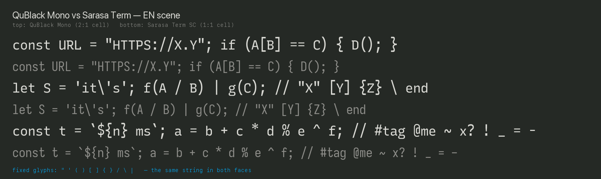

# 黢黑 Qu Black

A bilingual typeface family built for code: **Qu Black Mono** holds a strict **2:1** grid (one
hanzi = two ASCII cells, measured at 2.000), **Qu Black Sans** is its proportional sibling for
documents, web and UI. Both carry Source Han Sans hanzi (via Sarasa Gothic) and Recursive Linear
Latin, so the whole family is redistributable under the SIL Open Font License 1.1.



Site: **https://qublack.qqntt.com/** — specimen, measurements and downloads.
Release: **[v1.1.0](https://github.com/gjuoun/qublack/releases/tag/v1.1.0)** · Google Fonts
submission in progress (see `google-fonts/`) · CI:


## Family

| Family        | Use                | upm  | Hanzi   | ASCII   |
| ------------- | ------------------ | ---- | ------- | ------- |
| Qu Black Mono | terminal, code     | 833  | 1.200em | 0.600em |
| Qu Black Sans | documents, web, UI | 1000 | 1.000em | 0.600em |

Four styles each: Regular, Italic, Bold, Bold Italic.

## Download

`v1.2.0` assets on the GitHub release page — the eight static faces plus the two variable
faces, one wght-axis file per family. No font binary lives in this repository: `fonts/` is
git-ignored, `bash sources/build.sh` rebuilds the statics from the pinned inputs and
`bun run fonts:vf` rebuilds the variables. Releases are cut by
[the release pipeline](.github/workflows/release-pipeline.yml) — one dispatch builds, gates and
publishes them.
- **v1.2.0 (unreleased)** — variable faces: `QuBlackMono[wght].ttf` and `QuBlackSans[wght].ttf`
  span 400–700 as one file each, built from two masters (Noto Sans SC VF for hanzi, the Recursive
  variable donor for Latin). The static faces are unchanged; `reference/VF.md` records the
  interpolability measurements, the 15,940-glyph freeze (Hangul and the CJK tail outside Noto),
  the BASE/GPOS merge findings and the italic decision. Font binaries leave git: the repo now ships
  sources and build scripts only.
- **v1.1.0** — hanzi outlines now come from one weight-axis donor (Noto Sans SC VF,
  instanced at `wght` 400/700) instead of the two static Sarasa weights, so Regular and Bold share
  an interpolatable master design — the prerequisite for a variable font. Grid metrics, names and
  coverage are unchanged; `reference/CJK.md` records the measurements, the 2,482-codepoint donor
  boundary and the 0.0024 em worst-case ink delta.
- **v1.0.4** — clean name tables (the zh-CN records now read 黢黑等宽 QuBlack Mono / 黢黑比例
  Qu Black Sans, no Sarasa version strings or empty records) and an OTS fix that lets Chrome load the
  TTFs directly.
- **v1.0.3** — the full 44-symbol census: every CJK-adjacent mark sits on Sarasa's ink ratios.
- **v1.0.2** — the bracket set harmonised.
- **v1.0.1** — the mono `@` swapped for Recursive's `at.alt` alternate.

### Formats

| Format    | Files                                    | Use it for                                                                                   |
| --------- | ---------------------------------------- | -------------------------------------------------------------------------------------------- |
| **TTF**   | `QuBlackMono-*.ttf`, `QuBlackSans-*.ttf` | system install — macOS `~/Library/Fonts`, Linux `~/.local/share/fonts`, Windows double-click |
| **TTC**   | `QuBlackMono.ttc`, `QuBlackSans.ttc`     | the smaller bundle: four faces per file, shared tables                                       |
| **WOFF2** | `Qu Black*-*.woff2`                      | `@font-face` self-hosting on the web — **WOFF2, not WOFF1**                                  |

No OTF: the outlines are `glyf`; a CFF conversion would only cost size and hinting.

## Build

```sh
bun install
python3 -m pip install -r tools/requirements.txt
bash sources/build.sh           # eight faces into fonts/ttf/ from the pinned sources/ tree
bun run fonts:verify            # metrics against reference/baseline-v2.json
bun run fonts:weight            # CJK weight ratios + Regular/Bold interpolability
bun run fonts:audit             # name table, OFL notice, cmap, metrics
bun run fonts:probe             # load every face in Chrome (OTS) and render it
bun run fonts:web               # woff2 shards + unicode-range CSS for the site
bun run check                   # lint, typecheck, tests, site build
```

## Licence

- Fonts and font derivatives: **SIL Open Font License 1.1** (see `OFL.txt`).
- Site and tooling code: **MIT** (see `LICENSE-MIT`).
- Provenance and upstream licences: `NOTICE.md`.

## Credits

Qu Black is a derivative work, and it also borrows ideas. With thanks:

**Glyphs**
- [Sarasa Gothic](https://github.com/be5invis/Sarasa-Gothic) by Chen Qi's Sarasa contributors — the
  skeleton and CJK cells both families are built on (SIL OFL 1.1).
- [Source Han Sans](https://github.com/adobe-fonts/source-han-sans) by Adobe and Google — the hanzi
  ink Sarasa carries (SIL OFL 1.1).
- [Noto Sans SC](https://github.com/google/fonts/tree/main/ofl/notosanssc) — the variable instance
  the hanzi outlines are taken from since v1.1.0, same Source Han Sans design (SIL OFL 1.1).
- [Recursive](https://github.com/arrowtype/recursive) by ArrowType — every Latin outline, Mono and
  Sans (SIL OFL 1.1).

**Ideas and references**
- Sarasa's own Term/Mono split and its 2:1 alignment paradigm — why Qu Black Mono exists as a second
  family rather than another weight.
- The upm-833 optical trick (change `unitsPerEm`, leave every coordinate alone) that makes the mono
  cell read 1.200em against a 0.600em ASCII cell.
- Sarasa Term's symbol heights as the reference for the 44-symbol census
  (`tools/symbol_targets.py`).
- Recursive's `at.alt` alternate for the mono `@`.
- [commitmono.com](https://commitmono.com/) — the editable-specimen interaction this site's hero
  learns from.

No upstream Reserved Font Name is used; the family ships under new names with the OFL attribution
kept in name IDs 0 and 7.
